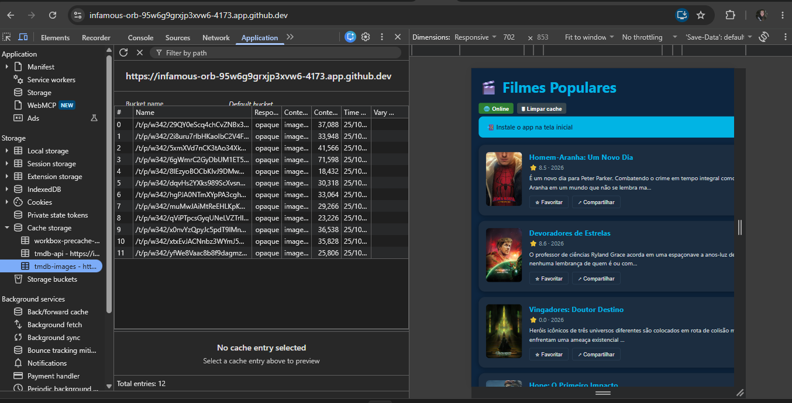
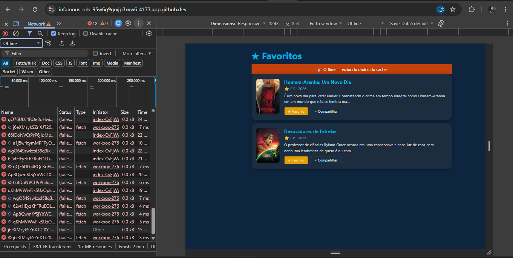
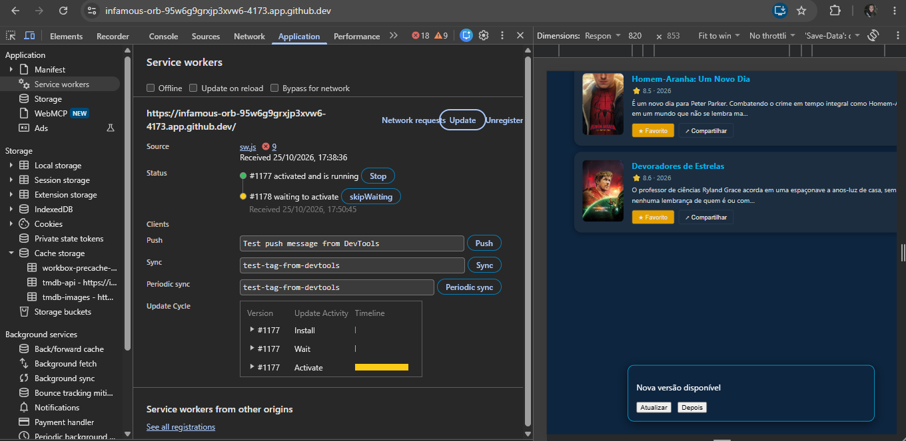
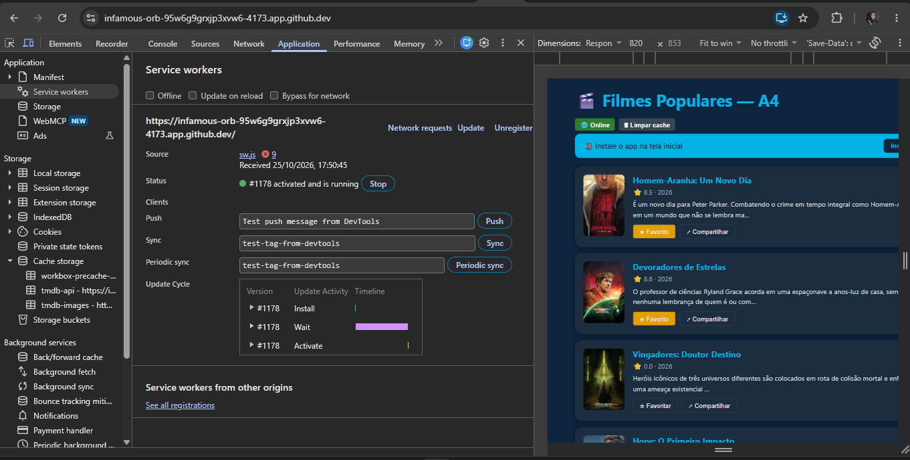
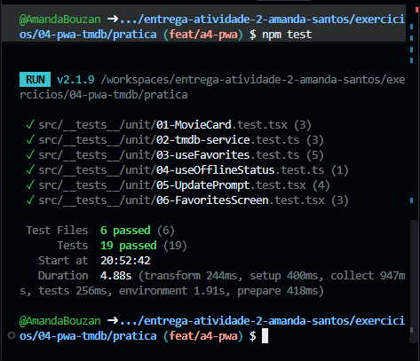

# ENTREGA — Atividade 4 (PWA)

**Nome:** Amanda Santos Pereira Bouzan · **GitHub:** AmandaBouzan

## 1. Site comum × PWA — comparação e observações

A execução do meu build foi realizada no Chrome, pelo Codespaces, em 25/10/2026.
Os prints abaixo registram os comportamentos observados no meu aplicativo.
A comparação direta com o PWA publicado pelo professor e um site comum ainda está
pendente; as propriedades do site comum na tabela são uma comparação técnica.

| # | Site comum sem recursos de PWA | O que observei no meu PWA | Evidência |
|---|---|---|---|
| 1 | Sem Service Worker/cache persistente planejado, uma nova navegação offline pode falhar. | Os caches da API e dos pôsteres estavam preenchidos; a aba Favoritos mostrou dois filmes com pôsteres e o banner offline com a rede desativada. | Prints 1, 2 e 3. |
| 2 | Normalmente abre em uma aba do navegador, sem instalação como aplicativo. | O Chrome apresentou a opção de instalação e a mensagem “Instale o app na tela inicial”. A instalação e reabertura em janela própria ainda não foram verificadas. | Print 5. |
| 3 | Uma nova navegação normalmente carrega a versão disponível no servidor. | A nova versão ficou em “waiting to activate”, com Atualizar/Depois. Após a confirmação, o título mudou para “Filmes Populares — A4” e os favoritos permaneceram. | Prints 4 e 5. |

Um site também pode implementar esses recursos; a comparação é com um site que
não utiliza manifest, Service Worker e estratégias explícitas de cache offline.

## 2. Evidências do meu build

Os prints são capturas originais da execução no navegador da aluna, sem alterações.
O token TMDB foi configurado somente no `.env.local`, ignorado pelo Git.

### 1 — API em cache

O cache `tmdb-api` contém uma resposta de `/3/movie/popular` em português.

### 2 — Pôsteres em cache

O cache `tmdb-images` contém 12 imagens com respostas opacas, aceitas pela regra
`cacheableResponse: { statuses: [0, 200] }`.

### 3 — Favoritos offline

Com o DevTools em Offline, a aba Favoritos manteve dois filmes e seus pôsteres,
exibindo “Offline — exibindo dados do cache”. As tentativas de rede que falharam
aparecem em vermelho no painel Network. O print demonstra o estado offline;
o ciclo de fechar e reabrir o app instalado ainda não foi registrado.

### 4 — Nova versão aguardando confirmação

Após alterar o título e gerar outro build, o worker #1178 ficou aguardando
ativação, enquanto o #1177 continuou ativo. O aplicativo mostrou o aviso e os
botões Atualizar/Depois. O botão Depois tem cobertura unitária; sua execução
manual não foi registrada.

### 5 — Atualização aplicada

Após clicar em Atualizar no aplicativo, o worker #1178 passou a ativo e o título
mudou para “Filmes Populares — A4”. Os dois favoritos continuaram marcados.
A alteração temporária do título foi usada para tornar a atualização visível.

### 6 — Testes automatizados

`npm test`: 6 arquivos e 19 testes aprovados no Codespaces.
`npm run build`: concluído com geração do Service Worker.
O validador estrutural local aprovou os 12 pontos automáticos; isso não substitui
a correção manual nem representa a nota final no Canvas.

### Pendências de observação

- Comparar diretamente o PWA do professor com um site comum.
- Instalar, fechar e reabrir o aplicativo; registrar o resultado.

## 3. Reflexão: autoUpdate × prompt

Para um checkout eu escolheria `prompt`, evitando recarregar a página durante o pagamento.
O aviso permite concluir a compra antes de ativar a nova versão.
O risco é manter uma versão antiga, então o servidor deve preservar compatibilidade e validar a transação.
Para um app de notícias eu escolheria `autoUpdate`, pois simplifica a adoção de correções e melhorias.
Mesmo nesse caso, uma recarga pode interromper a leitura e perder a posição do artigo.
Eu preservaria artigo e posição, e separaria a atualização das notícias da atualização do código do app.
Se o produto priorizasse leitura sem interrupções, usaria `prompt` também para notícias.

## 4. Declaração de uso de IA

Usei ChatGPT/Codex para interpretar o enunciado, implementar os TODOs, acrescentar
testes e preparar a documentação. Executei o projeto no Codespaces com meu token
TMDB e forneci os prints de cache, favoritos offline, atualização e testes.
A documentação distingue os comportamentos registrados das verificações pendentes.
